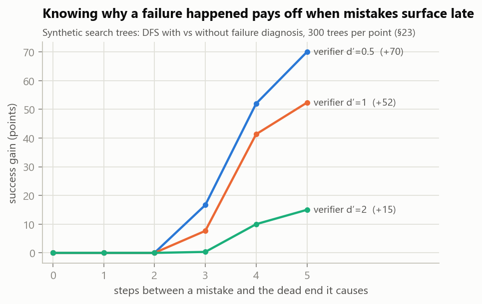
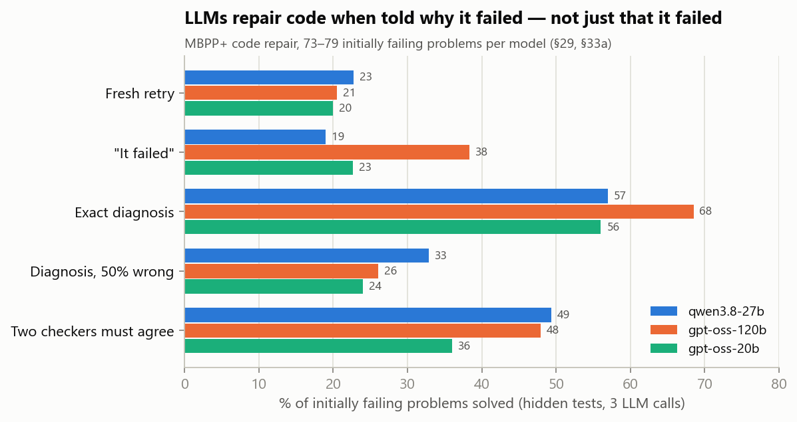
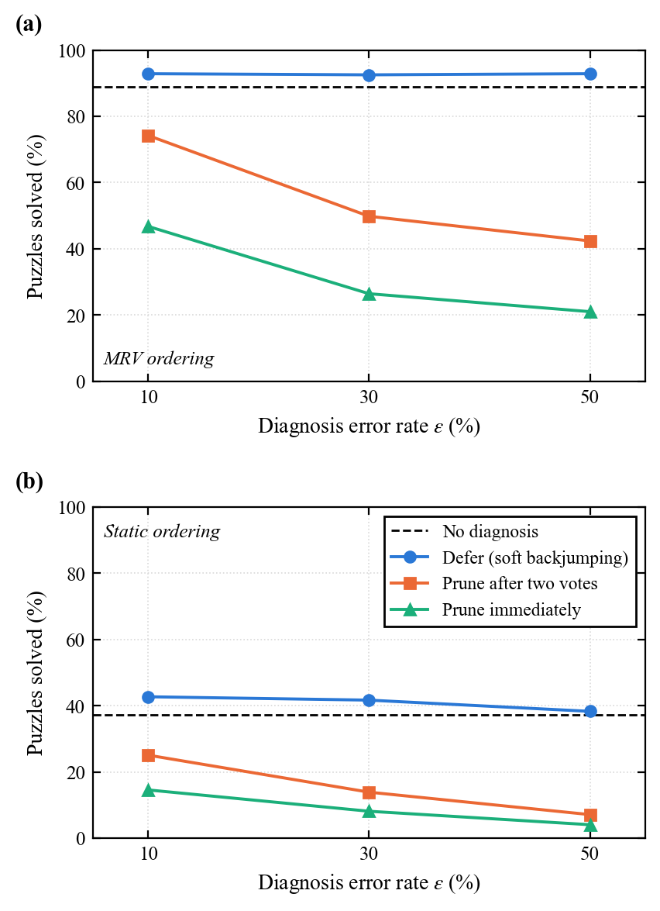
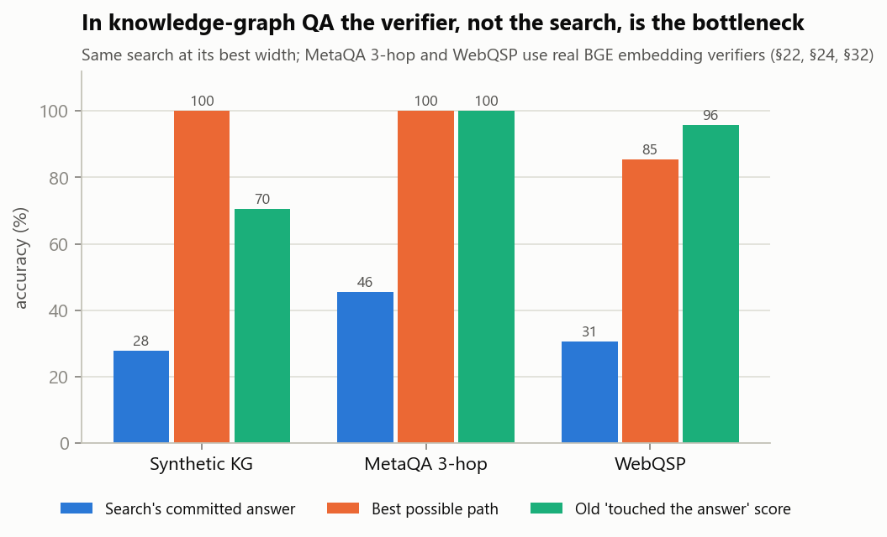

# DemoSearch (FAGS)

**When does learning from failure help a search agent?**

This started as FAGS (Failure-Aware Graph Search): a knowledge-graph search agent that remembers branches it rejected and revives the best one at a dead end. It grew into a study of failure feedback across synthetic search, Sudoku, two knowledge-graph QA datasets and LLM code repair. Every number below comes from the full research log, [`PROJECT_STATUS.md`](PROJECT_STATUS.md).

> **Reading the log:** start at **Section 21**. Sections 4–18 were run before a bug in the graph generator was fixed, so their numbers are unreliable; they are kept only as a record of how the project developed.

| Evaluated on | Scale |
|---|---|
| Synthetic knowledge graphs and search trees | 3 graph sizes × 3 seeds; up to 300 trees per condition |
| Sudoku (real puzzles, real heuristic, real failure explanations) | 295 hard puzzles |
| Knowledge-graph QA with BGE embedding verifiers | MetaQA (2,000 questions), WebQSP (500 questions) |
| LLM code repair (MBPP+ with held-out tests) | 3 models: qwen3.8-27b, gpt-oss-120b, gpt-oss-20b |

All comparisons are paired, with cluster-level tests and Holm correction; hypotheses were written down before each run.

## Key results

1. **A failure only helps if it says *why*.** A bare "dead end" can't change which option to try next (proved in Section 23), so reviving the best-scoring rejected branch, FAGS's core idea, never beat plain systematic search. A diagnosis that names the cause adds up to +70 points, and the later mistakes surface, the more it adds.
2. **The same holds for LLMs repairing code.** Telling the model *why* a test failed gives 2.5–3.3× the repair success of a fresh retry on all three models. Wrong diagnoses erase the gain; requiring two checkers to agree recovers much of it, while asking the model to double-check does not (Sections 29 and 33a).
3. **Defer, don't delete.** Classic backjumping prunes whatever a diagnosis blames, so one wrong diagnosis can delete the solution. Deferring the blamed branch instead ("soft backjumping", Section 30) costs nothing when diagnoses are right and stays above ignoring them even when half are wrong (Section 31).
4. **In knowledge-graph QA the verifier is the bottleneck, not the search.** Searching wider than ~3 hypotheses changes nothing, the best possible path beats what the search picks by 50–70 points, and scoring by whether the search ever *touched* the answer inflated accuracy 2–3× (Sections 22, 24 and 32).

<table>
  <tr>
    <td width="50%" valign="top"><br><sub><b>Figure 1.</b> Gain in success rate from using failure diagnoses, as a function of how many steps separate a mistake from the dead end it causes (synthetic trees, 300 per point, budget 100 expansions). (a) Depth-first search under three verifier strengths <i>d′</i>. (b) Four search policies at <i>d′</i> = 1. The gain is zero when failures surface immediately and grows with the delay (Section 23).</sub></td>
    <td width="50%" valign="top"><br><sub><b>Figure 2.</b> LLM code repair on MBPP+ problems whose first attempt failed: share solved on held-out tests within three LLM calls, by the feedback given after a failure. Gray: no diagnosis; blue: exact diagnosis; orange: diagnoses whose expected values are wrong half the time, handled four ways. Error bars are 95% bootstrap confidence intervals; (a)–(c) are the three models (Sections 29 and 33a).</sub></td>
  </tr>
  <tr>
    <td width="50%" valign="top"><br><sub><b>Figure 3.</b> Depth-first Sudoku search (295 hard puzzles, 20,000-step budget) when a fraction ε of failure diagnoses blame the wrong move. Deferring the blamed branch (soft backjumping) is compared with pruning it immediately or after two agreeing diagnoses; the dashed line ignores diagnoses. (a) MRV ordering, where mistakes surface quickly. (b) Static ordering, where they surface late (Section 31).</sub></td>
    <td width="50%" valign="top"><br><sub><b>Figure 4.</b> Knowledge-graph QA on a synthetic graph, MetaQA 3-hop and WebQSP. (a) Accuracy of the search's committed answer, of the best (oracle) relation path, and the inflated "goal-test" score the original code reported. (b) Accuracy against beam width: keeping more than about three hypotheses does not help, so the gap in (a) lies with the verifier, not the search (Sections 22, 24 and 32).</sub></td>
  </tr>
</table>

## Setup

```bash
pip install -r requirements.txt
```

LLM experiments need a Groq key: copy `.env.example` to `.env` and set `GROQ_API_KEY` (`.env` is git-ignored). Datasets go in `data/` (also git-ignored):

| Folder | Source (HuggingFace unless noted) |
|---|---|
| `data/metaqa/` | `camazlucas/MetaQA` |
| `data/sudoku/` | `sapientinc/sudoku-extreme` + norvig.com/top95.txt |
| `data/mbppplus/` | `evalplus/mbppplus` |
| `data/webqsp/` | `rmanluo/RoG-webqsp` |

## Run

Each script writes to `results/v2/`; section numbers refer to `PROJECT_STATUS.md`.

```bash
python revalidation_experiment.py             # Section 21 original claims, re-tested
python error_decomposition_experiment.py      # Section 22 honest scoring + error breakdown
python failure_informativeness_experiment.py  # Section 23 failure delay x diagnosis
python metaqa_experiment.py                   # Section 24 MetaQA
python noisy_diagnosis_experiment.py          # Section 27 wrong diagnoses
python sudoku_experiment.py                   # Section 28 Sudoku
python llm_feedback_experiment.py qwen/qwen3.8-27b && python llm_feedback_analysis.py   # Section 29 LLM repair
python soft_backjump_experiment.py            # Section 30 soft backjumping
python sudoku_noisy_experiment.py             # Section 31 Sudoku + wrong diagnoses (~2 h)
python webqsp_experiment.py                   # Section 32 WebQSP
python make_readme_figures.py                 # rebuild the figures above
```

The Section 33 LLM follow-ups add conditions via `LLM_EXTRA_CONDITIONS` (e.g. `noisy_vote2,noisy_verify` or `llm_diag,llm_diag_vote2`). LLM runs resume after quota limits, and every response is cached, so reruns are free.

## Code

| Path | What |
|---|---|
| `fags/graph_generator.py`, `verifier.py` | Synthetic knowledge graphs and verifiers |
| `fags/failure_search.py`, `beam_search.py`, `best_first_search.py`, `mcts_search.py` | Search algorithms (FAGS = `failure_search.py`) |
| `fags/delayed_failure.py` | Diagnostic-failure trees and recovery policies, incl. soft backjumping |
| `fags/sudoku_env.py` | Sudoku with conflict-set diagnosis |
| `fags/metaqa.py`, `webqsp.py` | Relation-path search with BGE verifiers |
| `fags/codegen.py`, `llm.py` | MBPP+ test harness and cached Groq client |
| `fags/committed.py`, `stats.py` | Commit-to-an-answer scoring; clustered tests with Holm correction |

Python · NumPy · SciPy · pandas · Matplotlib · sentence-transformers (BGE) · Groq
